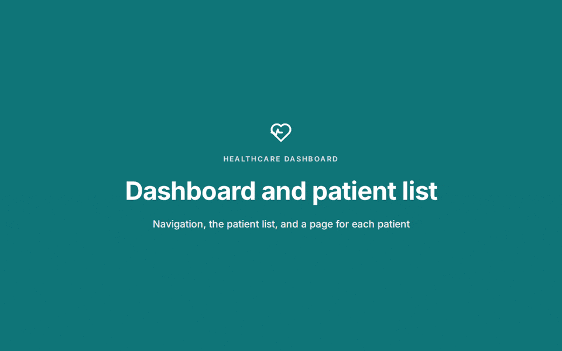
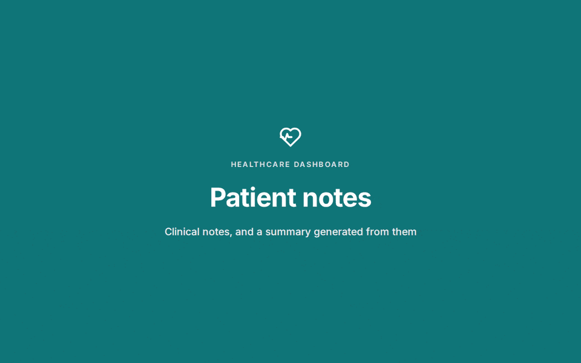
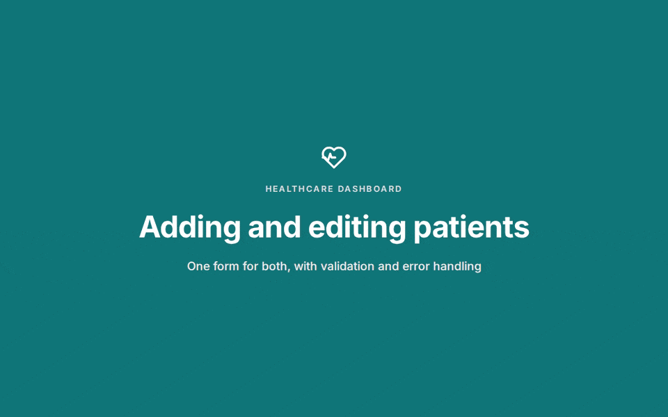

# Healthcare Dashboard

A patient management dashboard for a medical practice. The frontend is React and TypeScript, the backend is FastAPI, and the data is stored in PostgreSQL.

**[Open the live dashboard →](https://healthcare-dashboard-eight-delta.vercel.app)** It runs on sample data that is restored on every deploy, so feel free to add, edit and delete patients.

[](https://github.com/elliot-at-liminalnook/healthcare-dashboard/actions/workflows/ci.yml)

## Run locally

Docker with Compose is the only requirement.

```bash
docker compose up --build
```

| Service | URL |
|---|---|
| App | http://localhost:8080 |
| API | http://localhost:8000 (interactive documentation at `/docs`) |
| Logs and traces (Grafana) | http://localhost:3000 |

No configuration is needed. To change ports or database credentials, copy `.env.example` to `.env` and edit it.

When the backend starts, it applies the database migrations and, if the database is empty, loads 200 sample patients and their notes from [`backend/fixtures/patients.json`](backend/fixtures/patients.json). All of that data is invented. To go back to it after making changes, run `docker compose down -v` and start the stack again.

## Design

Two decisions shape the rest of the project.

**The API's types and rules are written once.** The backend's Pydantic models say what a patient is and what makes one valid. FastAPI turns those models into an OpenAPI schema, and Orval turns that schema into the TypeScript types, the data-fetching hooks and the form's validation. Nothing on the frontend declares an API type by hand. CI regenerates the client on every push and fails if it differs from what is committed.

**The interface is assembled from a component library.** Mantine supplies the page layout, the form inputs, the date picker and the notifications.

| Choice | Why it is here |
|---|---|
| FastAPI and Pydantic, on Python 3.14 | The request and response models are ordinary Python classes. The validation, the error responses and the API documentation all come from them. |
| PostgreSQL 18, with SQLAlchemy 2 (async, with asyncpg) and Alembic | SQLAlchemy supports the PostgreSQL features the data model uses, such as array columns and check constraints, and its queries are type-checked. Alembic writes each migration by comparing the models with the database. |
| Orval and Zod | Orval generates both the data-fetching hooks and the Zod schemas from one OpenAPI file, so a new endpoint can be called from the frontend as soon as `make client` has run. |
| TanStack Query | It holds everything that comes from the server, including caching, loading and error states, and refetching after a change. This is why the app has no global store. |
| React Router | The patient list keeps its search, filter, sort and page in the URL, so a reload, a shared link and the Back button all return to the same view. |
| Mantine 9, on React 19 | One library covers layout, inputs, dates, form state and notifications, and the whole theme is set in one file. |
| structlog and OpenTelemetry, viewed in Grafana | Both are vendor-neutral, so the logs and traces can go to any collector that accepts OTLP by changing one setting. |
| pytest and Playwright | pytest runs the API tests against a separate test database. The Playwright scripts test the app and record the GIFs below, so re-recording them after a change is one command. |
| TypeScript 7, Vite 8, uv, Ruff, oxlint, Prettier | The language and build tools. uv locks the Python dependencies, and Ruff, oxlint and Prettier do the linting and formatting. |

### Adding to it

Most changes are short because of this. To add a field to a patient, for example:

1. Add the column to the model and let Alembic write the migration.
2. Add the field and its rule to the Pydantic models.
3. Run `make client`. The TypeScript types and the form's validation schema now include the field.
4. Add the field to the form, and show it on the patient page.

[Adding a field to a patient](docs/adding-a-field.md) has the exact commands for each step, and what to do if one fails.

The form checks the new field against its rule without any validation code being written for it, and the TypeScript build checks every place the frontend reads it. A new endpoint works the same way: write the route, run `make client`, and call the generated hook.

## Feature tour

Each recording below is produced by a Playwright test in [`e2e/specs`](e2e/specs) that uses the running app and checks what it sees, so the recordings are also the end-to-end tests.

### Dashboard and patient list



Start on the dashboard and click one of the counts, and you land on the patient list already filtered to that status. From there you can search by name, sort by any column, page through all 200 patients, and open any patient's page.

- The server does the searching, sorting and paging, so the browser only ever holds one page of patients.
- Searching doesn't blank the list. The current rows stay where they are until the new ones arrive.
- The search, sort and page are all in the URL. You can share a link to exactly what you're looking at, and the Back button takes you back to it.

### Patient notes



Every patient page opens with a short written summary, built from their profile and their notes. When you add a note, it appears at the top of the list and the summary is rewritten to include it. Delete the note and the summary changes back.

- The summary is built from a template, not a language model, so it needs no API key and no patient data leaves the app. The code that writes it ([`summary.py`](backend/app/services/summary.py)) sits behind a small interface, so a language model could replace it later without changing the endpoint.
- A note can only be reached through its own patient. One patient's URL can't be used to read or delete another patient's notes.

### Adding and editing patients



One form handles both adding and editing a patient. It catches missing fields and badly formatted ones as you fill it in. When the server rejects something the browser had no way to check, the message appears under the field it's about. If the connection drops while saving, the form says so and keeps everything you typed.

- The validation rules are written once, in the backend ([`backend/app/schemas`](backend/app/schemas)). The form's checks are generated from the API's schema, so the two always agree.
- A few rules depend on today's date, which that schema can't express. The server checks those, and the form shows its answer.

### Logging and tracing


The browser and the backend both write structured logs. Every API call carries a trace ID from the browser to the API, and both sides write that ID into their logs. In the recording, a patient's phone number is changed and saved. Searching Grafana for that request's trace ID finds two log lines, one from the browser and one from the API, and the trace follows the request down to the SQL `UPDATE` that changed the row.

To look at this locally, open Grafana at http://localhost:3000, go to Explore, and choose Loki for logs (the query is `{service_name=~"healthcare-.+"}`) or Tempo for traces. To turn it off, set `OTLP_ENDPOINT=` (empty) in `.env`. The app works without Grafana. Health checks are not logged or traced, and patient data should not be written to logs or trace attributes.

## Project layout

```
backend/
  app/
    api/routes/   route handlers, one module per resource
    schemas/      request and response models, including the validation rules
    services/     database queries and writes
    models/       SQLAlchemy models
    core/         settings, database session, logging, telemetry
  fixtures/  migrations/  scripts/  tests/
frontend/src/
  api/            fetch wrapper, and the generated client in generated/
  app/            router, layout, theme, query client, error pages
  features/       one folder per feature: dashboard, patients, notes
  telemetry/      logger and OpenTelemetry setup
e2e/              Playwright tests, which also record the GIFs above
```

## API

The API has endpoints for patients, for a patient's notes, and for a patient's summary. The interactive documentation lists all of them with their request and response schemas. It is at `/docs` when running locally, and [here on the live site](https://healthcare-dashboard-eight-delta.vercel.app/api/docs).

`GET /patients` accepts these query parameters, and returns `{items, total, page, page_size}`:

| Parameter | Meaning |
|---|---|
| `page`, `page_size` | Which page to return, and how many patients per page (up to 100) |
| `search` | Words to look for in the first or last name |
| `status` | `active`, `inactive` or `critical` |
| `sort_by` | `name`, `age`, `last_visit` or `status` |
| `sort_order` | `asc` or `desc` |

An unknown id returns 404. Invalid input returns 422 with one entry for each problem. Each entry names the field, an error code and a message:

```json
{ "loc": ["body", "date_of_birth"], "type": "date_in_future", "msg": "Cannot be in the future" }
```

The data is stored in two tables, `patients` and `patient_notes`, which are defined in [`backend/app/models/patient.py`](backend/app/models/patient.py). A patient's age is calculated from their date of birth and is not stored. Deleting a patient also deletes their notes.

## Development

`make dev` starts the same stack with the source code mounted into the containers. Saving a file in `backend/app` restarts the API, and saving a file in `frontend/src` updates the page in the browser without a reload.

```bash
make dev      # start the stack with hot reload
make test     # run the backend tests against a separate test database
make lint     # run Ruff, oxlint and Prettier
make client   # regenerate the frontend API client after changing the API
make lock     # update backend/uv.lock after changing dependencies
make demos    # run the end-to-end tests and re-record the GIFs (the stack must be running)
```

The OpenAPI schema and the client generated from it are both committed, so a change to the API is visible in code review.

[GitHub Actions](.github/workflows/ci.yml) runs on every push and pull request. It lints and tests the backend and checks that the migrations match the models. It lints, type-checks and builds the frontend. It checks that the committed API client matches a freshly generated one. Finally, it starts the app with Docker Compose and runs the end-to-end tests against it.

The live demo runs on Vercel, with PostgreSQL from Neon, and every push to `main` is deployed. [`vercel.json`](vercel.json) defines the frontend and the API as two services in one project. Before each deploy, [`scripts/release.py`](backend/scripts/release.py) applies the database migrations and restores the sample data. Log and trace export is turned off there, because the demo has no Grafana.
