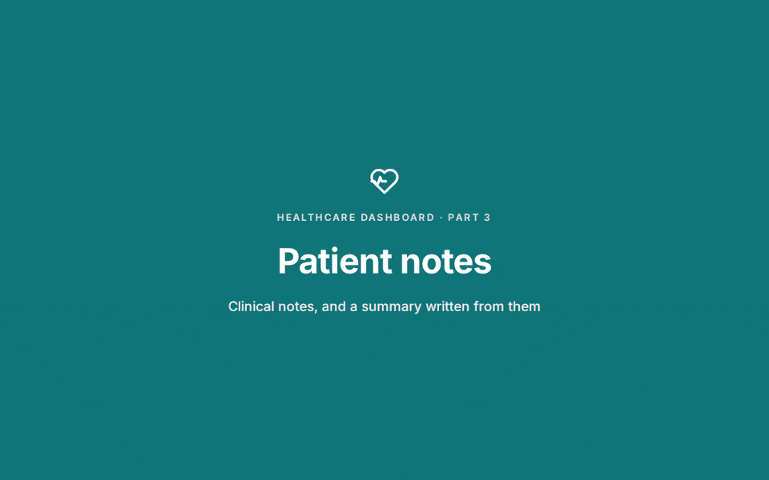

# Healthcare Dashboard

A patient management dashboard for a medical practice.

## Run locally

Requires Docker with Compose.

```bash
docker compose up --build
```

| What | URL |
|---|---|
| App | http://localhost:8080 |
| API | http://localhost:8000 (interactive docs at `/docs`) |
| Logs and traces (Grafana) | http://localhost:3000 |

Every setting has a working default. To change ports or database credentials, copy `.env.example` to `.env` and edit it.

On startup the backend applies database migrations, loads 200 sample patients into an empty database, then serves the API. The frontend is served by nginx, which forwards `/api/*` to the backend.

## Feature tour

Each clip below is recorded from a Playwright spec in [`e2e/specs`](e2e/specs) that drives the real app and asserts on what it sees, so the demos are also end-to-end tests and cannot drift from the product.

### Part 2 · The core dashboard


The dashboard's counts link into a list of 200 patients that is paged, searched and sorted by the server. Every patient has a page, the sidebar collapses, and unknown URLs get a proper 404.

| Capability | Made possible by | Why it is built this way |
|---|---|---|
| Header, sidebar, content area, 404 | Mantine `AppShell`; React Router nested routes | The layout is one route element and pages render into its `<Outlet>`. The sidebar's phone and desktop behaviour is configuration, not code. |
| 100+ patients stay fast | FastAPI and SQLAlchemy: `LIMIT`/`OFFSET` plus a count | The browser only ever holds one page. List items carry four fields; contact and medical details stay on the patient's own endpoint. |
| Search that never blocks | TanStack Query `keepPreviousData`; Mantine `useDebouncedCallback` | The current rows stay on screen, dimmed, until the next result arrives, and typing sends one request per pause rather than one per key. |
| Page, search, filter and sort in the URL | React Router `useSearchParams`, wrapped in [`usePatientListState`](frontend/src/features/patients/usePatientListState.ts) | The URL is the only copy of the view state, so views are shareable, Back works, and no client-side store is needed. |
| Typed API calls | Orval, generating TanStack Query hooks from the OpenAPI schema | `useListPatients({ search, sort_by })` is checked against the backend's own types at build time. |
| Right status codes, useful errors | FastAPI and Pydantic | 404 for unknown ids; 422 with one message per invalid field. |

### Part 3 · Patient notes



A patient's page opens with a summary written from their profile and notes. Notes are added and deleted in a timeline, and the summary rewrites itself as they change.

| Capability | Made possible by | Why it is built this way |
|---|---|---|
| Add, list and delete notes | A FastAPI router nested under `/patients/{id}`, sharing one `PatientDep` dependency | Every notes route gets "load the patient or return 404" for free. A note is only ever looked up through its patient, so it cannot be deleted through another patient's URL. |
| The summary endpoint | A `Summarizer` protocol, injected with FastAPI `Depends`; [`TemplateSummarizer`](backend/app/services/summary.py) by default | The route does not know how the text is produced. The default is deterministic, needs no API key and sends patient data nowhere. A language model is a drop-in replacement, and a test swaps the summariser to prove the seam. |
| A narrative, not a list | Sentence-boundary excerpts, in time order, dated in the practice's time zone (`zoneinfo`) | It opens with the first note, counts the ones in between, and quotes the most recent, so it reads the same for 2 notes or 20. |
| Summary and timeline stay in step | TanStack Query cache invalidation | Adding or deleting a note marks both queries stale and they refetch. There is no hand-written state to keep in sync. |
| Timeline, form, date-time picker, confirm dialog, toasts | Mantine `Timeline`, `@mantine/form`, `DateTimePicker`, `Modal`, `@mantine/notifications` | Standard components throughout. An empty note is caught in the browser; anything the server rejects is shown under the field it concerns. |
| Unambiguous timestamps | Pydantic `AwareDatetime` | A note's time must carry a UTC offset and cannot be in the future, so "when" means the same instant everywhere. |

### Part 4 · Forms and validation


Adding and editing a patient share one form. The browser checks the same rules as the API, the server has the final say, and a validation problem and a dropped connection each have a clear place on screen.

| Capability | Made possible by | Why it is built this way |
|---|---|---|
| One set of validation rules | Pydantic models, then the OpenAPI schema, then Zod schemas generated by Orval | Required fields, lengths, email format and allowed values are written once, in [`backend/app/schemas`](backend/app/schemas). `make client` regenerates the Zod schemas the form validates with, so changing a rule in Python changes the form. |
| Messages a person can act on | A small error map in [`validation.ts`](frontend/src/api/validation.ts); Pydantic custom errors on the server | "Required" and "Enter a valid email address", not library jargon. Each server rule has a stable code and a plain sentence. |
| Server-side validation, shown in place | The API's 422 response mapped onto fields by [`fieldErrors`](frontend/src/api/errors.ts) | Rules only the server can check, such as a last visit before the date of birth, appear under the field they concern, and the form scrolls to the first one. |
| Network failures | `http.ts` raises `NetworkError` separately from `ApiError` | "Could not reach the server" is shown above the form, nothing typed is lost, and saving again just works. |
| Form state | `@mantine/form` in uncontrolled mode; one `PatientForm` for both create and edit | No re-render on every keystroke. Create and edit differ only in their starting values and which mutation they call. |
| Dates, tags and choices | Mantine `DateInput`, `TagsInput`, `Select` | Dates can be typed or picked and cannot be in the future; conditions and allergies offer common suggestions. |
| Everything else stays current | TanStack Query invalidation after each write | The list, the dashboard counts and the patient's summary refetch on their own. |

Date rules that depend on today's date cannot be expressed in an OpenAPI schema, so the pickers prevent the obvious cases and the server enforces all of them.

## Stack

| Layer | Choice |
|---|---|
| Frontend | React 19, TypeScript 7, Vite 8, Mantine 9, TanStack Query, React Router |
| State | Server data in TanStack Query; list view state in the URL; form state in `@mantine/form`. There is no global store, because nothing needs one. |
| API client | Typed TanStack Query hooks and Zod validation schemas, both generated from the backend's OpenAPI schema with Orval |
| Backend | Python 3.15, FastAPI, SQLAlchemy 2 (async, asyncpg), Alembic, uv |
| Database | PostgreSQL 18 |
| Logging and tracing | structlog and OpenTelemetry (backend); OpenTelemetry web SDK (frontend); Grafana for viewing |
| Tooling | Ruff and pytest (backend); oxlint and Prettier (frontend) |

## Layout

```
backend/
  app/
    api/routes/   route handlers, one module per resource
    core/         settings, database session, logging, telemetry
    models/       SQLAlchemy models
    schemas/      request and response shapes, with validation rules
    services/     queries and writes; no HTTP knowledge
    main.py       application factory
  fixtures/       patients.json: 200 synthetic patients with clinical notes
  migrations/     Alembic migrations
  scripts/        seed.py, generate_fixture.py, export_openapi.py
  tests/
e2e/              Playwright specs that double as recorded demos
docs/demos/       the recorded GIFs
frontend/
  src/
    api/          http.ts (fetch wrapper), error and validation helpers, and
                  generated/ (typed hooks and Zod schemas, do not edit)
    app/          router, layout, theme, query client, error pages
    features/     one folder per feature (dashboard, patients, notes)
    telemetry/    logger and OpenTelemetry setup
docker-compose.yml
```

## API

| Method and path | Purpose |
|---|---|
| `GET /health` | Liveness check, returns `{"status": "ok"}` |
| `GET /patients` | One page of patients. Query: `page`, `page_size` (max 100), `search` (words matched against first and last name), `status`, `sort_by` (`name`, `age`, `last_visit`, `status`), `sort_order` |
| `GET /patients/{id}` | One patient's full record |
| `POST /patients` | Create a patient (201) |
| `PUT /patients/{id}` | Replace a patient |
| `DELETE /patients/{id}` | Delete a patient and their notes (204) |
| `GET /patients/{id}/notes` | The patient's notes, newest first |
| `POST /patients/{id}/notes` | Add a note: `timestamp` (with UTC offset) and `content` (201) |
| `DELETE /patients/{id}/notes/{note_id}` | Delete a note (204) |
| `GET /patients/{id}/summary` | A readable summary: identifiers, conditions and allergies, and a narrative of the notes |

- The list returns `{items, total, page, page_size}`, and each item carries only what the list shows (name, age, status, last visit), not contact or medical details.
- Unknown ids return 404. Invalid input returns 422 with one entry per problem, each naming its field, a stable `type` code and a plain-language message, for example `{"loc": ["body", "date_of_birth"], "type": "date_in_future", "msg": "Cannot be in the future"}`.
- Validation rules live in one place, `backend/app/schemas/patient.py`, as reusable types. They flow into the OpenAPI schema and from there into the generated frontend types.

## Data model

| Table | Columns |
|---|---|
| `patients` | `id`, `first_name`, `last_name`, `date_of_birth`, `email`, `phone`, `address_line1`, `address_line2`, `city`, `state`, `postal_code`, `blood_type`, `allergies[]`, `conditions[]`, `status`, `last_visit`, `created_at`, `updated_at` |
| `patient_notes` | `id`, `patient_id`, `timestamp`, `content`, `created_at` |

- Age is computed from `date_of_birth`, never stored.
- `status` is `active`, `inactive` or `critical`; `blood_type` is one of the eight ABO/Rh types or empty when not on file.
- Deleting a patient deletes their notes.

### Sample data

`backend/fixtures/patients.json` holds 200 patients and 448 notes. All of it is synthetic: invented names, `example.com` emails and fictional `555-01xx` phone numbers. It is produced by a seeded generator (`python -m scripts.generate_fixture`), so it is reproducible, and a test fails if the file and generator drift apart. To reload it, remove the database volume: `docker compose down -v`.

## Logging and tracing

Both ends log in a structured way, and one trace follows a request from the browser to the database.

- **Backend:** one JSON log line per request (method, path, status, duration) on stderr, plus anything logged with `structlog.get_logger()`. Every line carries the request's `trace_id`. Requests and SQL queries are traced.
- **Frontend:** `logger` (`src/telemetry/logger.ts`) writes to the console. Failed API calls, render errors and uncaught errors are logged automatically. API calls send a `traceparent` header, so backend logs and spans join the browser's trace.
- **Viewing:** both ends export to the bundled Grafana stack at http://localhost:3000. Use Explore: Loki for logs (`{service_name=~"healthcare-.+"}`), Tempo for traces. The browser's telemetry goes through nginx (`/otlp`), so no extra port is exposed.
- **Turning it off:** set `OTLP_ENDPOINT=` (empty) in `.env`. The app does not depend on Grafana; if it is down, telemetry is dropped.

Health checks are neither logged nor traced. Do not put patient data in log fields or span attributes.

## Development

```bash
make test     # backend tests, against a separate test database
make lint     # ruff, oxlint, prettier
make client   # regenerate the typed API client after changing the API
make lock     # update backend/uv.lock after changing dependencies
make demos    # re-record the feature-tour GIFs (needs the stack running)
```

To work on the frontend with hot reload, start the stack, then run the Vite dev server (Node 22+), which proxies `/api` to the backend on port 8000. Set `VITE_TELEMETRY_ENABLED=true` to export telemetry from the dev server to a collector on port 4318.

```bash
cd frontend
npm install
npm run dev
```

### The typed API client

The frontend never hand-writes API calls. `make client` exports the OpenAPI schema from the FastAPI app to `frontend/openapi.json`, and Orval generates typed TanStack Query hooks and Zod validation schemas from it into `frontend/src/api/generated/`. Both are committed, so API changes show up in review as a diff.
