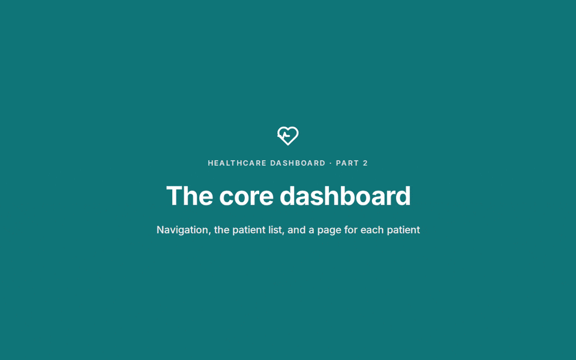
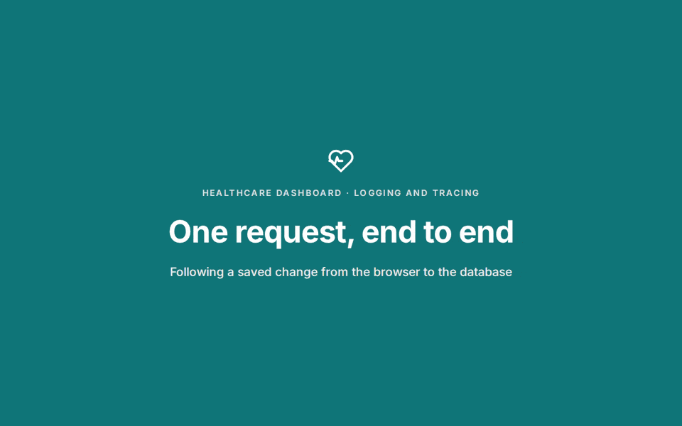

# Healthcare Dashboard

[](https://github.com/elliot-at-liminalnook/healthcare-dashboard/actions/workflows/ci.yml)

A patient management dashboard for a medical practice. The frontend is React and TypeScript, the backend is FastAPI, and the data is stored in PostgreSQL.

## Run locally

Docker with Compose is the only requirement.

```bash
docker compose up --build
```

| Service | URL |
|---|---|
| App | http://localhost:8080 |
| API | http://localhost:8000 (interactive documentation at `/docs`) |
| Logs and traces (Grafana) | http://localhost:3000 |

No configuration is needed. To change ports or database credentials, copy `.env.example` to `.env` and edit it.

When the backend starts, it applies the database migrations and loads 200 sample patients if the database is empty.

## Feature tour

The three recordings below correspond to Parts 2, 3 and 4 of the brief. Each one is produced by a Playwright test in [`e2e/specs`](e2e/specs) that uses the running app and checks what it sees, so the recordings are also the end-to-end tests.

### Part 2: The core dashboard



Start on the dashboard and click one of the counts, and you land on the patient list already filtered to that status. From there you can search by name, sort by any column, page through all 200 patients, and open any patient's page.

- The server does the searching, sorting and paging, so the browser only ever holds one page of patients.
- Searching doesn't blank the list. The current rows stay where they are until the new ones arrive.
- The search, sort and page are all in the URL. You can share a link to exactly what you're looking at, and the Back button takes you back to it.

### Part 3: Patient notes


Every patient page opens with a short written summary, built from their profile and their notes. When you add a note, it appears at the top of the list and the summary is rewritten to include it. Delete the note and the summary changes back.

- The summary is built from a template, not a language model, so it needs no API key and no patient data leaves the app. The code that writes it ([`summary.py`](backend/app/services/summary.py)) sits behind a small interface, so a language model could replace it later without changing the endpoint.
- A note can only be reached through its own patient. One patient's URL can't be used to read or delete another patient's notes.

### Part 4: Forms and validation


One form handles both adding and editing a patient. It catches missing fields and badly formatted ones as you fill it in. When the server rejects something the browser had no way to check, the message appears under the field it's about. If the connection drops while saving, the form says so and keeps everything you typed.

- The validation rules are written once, in the backend ([`backend/app/schemas`](backend/app/schemas)). The form's checks are generated from the API's schema, so the two always agree.
- A few rules depend on today's date, which that schema can't express. The server checks those, and the form shows its answer.

## Stack

| Area | Choice |
|---|---|
| Frontend | React 19, TypeScript 7, Vite 8, Mantine 9, TanStack Query, React Router |
| State management | Data from the server is held by TanStack Query. The patient list's view state is held in the URL. Form state is held by `@mantine/form`. The app does not use a global store. |
| API client | TanStack Query hooks and Zod schemas, generated from the backend's OpenAPI schema by Orval |
| Backend | Python 3.14, FastAPI, SQLAlchemy 2 (async, with asyncpg), Alembic, uv |
| Database | PostgreSQL 18 |
| Logging and tracing | structlog and OpenTelemetry in the backend, the OpenTelemetry web SDK in the browser, and Grafana to view them |
| Testing and tooling | pytest, Ruff, oxlint, Prettier, Playwright, GitHub Actions |

## Project layout

```
backend/
  app/
    api/routes/   route handlers, one module per resource
    core/         settings, database session, logging, telemetry
    models/       SQLAlchemy models
    schemas/      request and response models, including validation rules
    services/     database queries and writes
    main.py       creates the application
  fixtures/       patients.json: 200 sample patients with clinical notes
  migrations/     Alembic migrations
  scripts/        seed.py, generate_fixture.py, export_openapi.py
  tests/
frontend/
  src/
    api/          fetch wrapper, error and validation helpers, and
                  generated/ (generated code; do not edit by hand)
    app/          router, layout, theme, query client, error pages
    features/     one folder per feature: dashboard, patients, notes
    telemetry/    logger and OpenTelemetry setup
e2e/              Playwright tests, which also record the GIFs above
docs/demos/       the recorded GIFs
docker-compose.yml
docker-compose.dev.yml   adds hot reload (see Development)
```

## API

| Method and path | Description |
|---|---|
| `GET /health` | Returns `{"status": "ok"}` |
| `GET /patients` | Returns one page of patients |
| `GET /patients/{id}` | Returns one patient's full record |
| `POST /patients` | Creates a patient (201) |
| `PUT /patients/{id}` | Replaces a patient |
| `DELETE /patients/{id}` | Deletes a patient and their notes (204) |
| `GET /patients/{id}/notes` | Returns the patient's notes, newest first |
| `POST /patients/{id}/notes` | Adds a note with a `timestamp` and `content` (201) |
| `DELETE /patients/{id}/notes/{note_id}` | Deletes a note (204) |
| `GET /patients/{id}/summary` | Returns a written summary of the patient |

`GET /patients` accepts these query parameters:

| Parameter | Meaning |
|---|---|
| `page`, `page_size` | Which page to return, and how many patients per page (up to 100) |
| `search` | Words to look for in the first or last name |
| `status` | `active`, `inactive` or `critical` |
| `sort_by` | `name`, `age`, `last_visit` or `status` |
| `sort_order` | `asc` or `desc` |

The response is `{items, total, page, page_size}`.

An unknown id returns 404. Invalid input returns 422 with one entry for each problem. Each entry names the field, an error code and a message:

```json
{ "loc": ["body", "date_of_birth"], "type": "date_in_future", "msg": "Cannot be in the future" }
```

## Data model

| Table | Columns |
|---|---|
| `patients` | `id`, `first_name`, `last_name`, `date_of_birth`, `email`, `phone`, `address_line1`, `address_line2`, `city`, `state`, `postal_code`, `blood_type`, `allergies[]`, `conditions[]`, `status`, `last_visit`, `created_at`, `updated_at` |
| `patient_notes` | `id`, `patient_id`, `timestamp`, `content`, `created_at` |

- A patient's age is calculated from `date_of_birth`. It is not stored.
- `status` is `active`, `inactive` or `critical`.
- `blood_type` is one of the eight ABO and Rh types, or empty if it is not on file.
- Deleting a patient also deletes their notes.

### Sample data

[`backend/fixtures/patients.json`](backend/fixtures/patients.json) contains 200 patients and 448 notes. All of it is invented. Email addresses use `example.com` and phone numbers use the fictional `555-01xx` range.

The file is produced by `python -m scripts.generate_fixture`, which gives the same result every time it runs. A test fails if the file and the generator no longer match.

To reload the sample data, delete the database volume with `docker compose down -v` and start the stack again.

## Logging and tracing

The backend and the browser both produce structured logs, and a single trace follows a request from the browser to the database.



In the recording, a patient's phone number is changed and saved. In Grafana, searching for that request's trace ID finds two log lines, one written by the browser and one by the API. The trace for the same ID follows the request from the browser, through the API, down to the SQL `UPDATE` that changed the row.

This works because every API call carries a trace ID from the browser to the API, and both sides write that ID into their logs.

- **Viewing.** Both send their logs and traces to Grafana at http://localhost:3000. In Grafana, open Explore, then choose Loki for logs (query `{service_name=~"healthcare-.+"}`) or Tempo for traces.
- **Turning it off.** Set `OTLP_ENDPOINT=` (empty) in `.env`. The app works without Grafana.

Health checks are not logged or traced. Patient data should not be written to logs or trace attributes.

## Development

### Hot reload

```bash
make dev
```

This starts the same stack with the source code mounted into the containers. Saving a file in `backend/app` restarts the API. Saving a file in `frontend/src` updates the page in the browser without a reload. The URLs are the same as above.

### Commands

```bash
make test     # run the backend tests against a separate test database
make lint     # run Ruff, oxlint and Prettier
make client   # regenerate the frontend API client after changing the API
make lock     # update backend/uv.lock after changing dependencies
make demos    # run the end-to-end tests and re-record the GIFs (the stack must be running)
```

### Generated API client

`make client` exports the OpenAPI schema from the backend to `frontend/openapi.json`. Orval then generates TanStack Query hooks and Zod schemas from it into `frontend/src/api/generated/`. The schema and the generated code are both committed, so a change to the API is visible in code review.

### Continuous integration

[`.github/workflows/ci.yml`](.github/workflows/ci.yml) runs four jobs on every push and pull request:

| Job | What it checks |
|---|---|
| Backend | Linting and formatting, that the migrations apply to an empty database, that the models match the migrations, and the tests |
| Frontend | Linting and formatting, type checking, and the production build |
| Generated API client | That the committed client matches a freshly generated one |
| End-to-end | Starts the app with Docker Compose and runs the Playwright tests. The recorded GIFs are saved with the run. |
