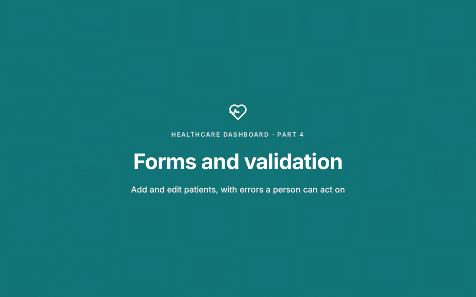

# Healthcare Dashboard

[](https://github.com/elliot-at-liminalnook/healthcare-dashboard/actions/workflows/ci.yml)

A patient management dashboard for a medical practice. The frontend is React and TypeScript, the backend is FastAPI, and the data is stored in PostgreSQL.

## Run locally

Docker with Compose is the only requirement.

```bash
docker compose up --build
```

| Service | URL |
|---|---|
| App | http://localhost:8080 |
| API | http://localhost:8000 (interactive documentation at `/docs`) |
| Logs and traces (Grafana) | http://localhost:3000 |

No configuration is needed. To change ports or database credentials, copy `.env.example` to `.env` and edit it.

When the backend starts, it applies the database migrations and loads 200 sample patients if the database is empty.

## Feature tour

The three recordings below correspond to Parts 2, 3 and 4 of the brief. Each one is produced by a Playwright test in [`e2e/specs`](e2e/specs) that uses the running app and checks what it sees, so the recordings are also the end-to-end tests.

### Part 2: The core dashboard


What the recording shows:

- The dashboard shows how many patients are in each status. Each count links to the patient list, filtered by that status.
- The patient list holds 200 patients. It can be searched by name, filtered by status, sorted by any column and paged.
- Each patient has a page with their personal and medical information.
- The sidebar can be collapsed. An unknown URL shows a "Page not found" page.

Worth noting:

- The server does the paging, searching and sorting, so the browser holds one page of patients at a time.
- While a search is loading, the current rows stay on screen until the new results arrive.
- The page, search and sort order are stored in the URL, so a view can be shared and the Back button returns to it.

### Part 3: Patient notes


What the recording shows:

- Each patient page opens with a summary generated from the patient's profile and notes.
- Notes are listed from newest to oldest. A note can be added or deleted, and deleting requires confirmation.
- The summary is regenerated whenever a note is added or deleted.

Worth noting:

- The summary is written by a `Summarizer` that the route receives as a dependency. The default, [`TemplateSummarizer`](backend/app/services/summary.py), builds it from a template, so it needs no API key and sends no patient data to another service. A language model could replace it without changing the route.
- A note is always looked up through its patient, so it cannot be read or deleted through another patient's URL.

### Part 4: Forms and validation



What the recording shows:

- A patient is added and edited with the same form.
- Required fields and formats are checked in the browser. Each field is checked again when it loses focus.
- The server checks rules the browser cannot, such as a last visit that is before the date of birth. Its errors are shown under the field they apply to.
- If the connection fails, an error is shown above the form and the form keeps what was entered.
- Deleting a patient requires confirmation.

Worth noting:

- The validation rules are written once, in the backend's Pydantic models in [`backend/app/schemas`](backend/app/schemas). Orval generates Zod schemas from the API's OpenAPI schema, and the form validates with those, so changing a rule in the backend changes the form.
- Rules that depend on today's date cannot be described in an OpenAPI schema, so the server enforces them and the form shows its answer under the right field.

## Stack

| Area | Choice |
|---|---|
| Frontend | React 19, TypeScript 7, Vite 8, Mantine 9, TanStack Query, React Router |
| State management | Data from the server is held by TanStack Query. The patient list's view state is held in the URL. Form state is held by `@mantine/form`. The app does not use a global store. |
| API client | TanStack Query hooks and Zod schemas, generated from the backend's OpenAPI schema by Orval |
| Backend | Python 3.14, FastAPI, SQLAlchemy 2 (async, with asyncpg), Alembic, uv |
| Database | PostgreSQL 18 |
| Logging and tracing | structlog and OpenTelemetry in the backend, the OpenTelemetry web SDK in the browser, and Grafana to view them |
| Testing and tooling | pytest, Ruff, oxlint, Prettier, Playwright, GitHub Actions |

## Project layout

```
backend/
  app/
    api/routes/   route handlers, one module per resource
    core/         settings, database session, logging, telemetry
    models/       SQLAlchemy models
    schemas/      request and response models, including validation rules
    services/     database queries and writes
    main.py       creates the application
  fixtures/       patients.json: 200 sample patients with clinical notes
  migrations/     Alembic migrations
  scripts/        seed.py, generate_fixture.py, export_openapi.py
  tests/
frontend/
  src/
    api/          fetch wrapper, error and validation helpers, and
                  generated/ (generated code; do not edit by hand)
    app/          router, layout, theme, query client, error pages
    features/     one folder per feature: dashboard, patients, notes
    telemetry/    logger and OpenTelemetry setup
e2e/              Playwright tests, which also record the GIFs above
docs/demos/       the recorded GIFs
docker-compose.yml
docker-compose.dev.yml   adds hot reload (see Development)
```

## API

| Method and path | Description |
|---|---|
| `GET /health` | Returns `{"status": "ok"}` |
| `GET /patients` | Returns one page of patients |
| `GET /patients/{id}` | Returns one patient's full record |
| `POST /patients` | Creates a patient (201) |
| `PUT /patients/{id}` | Replaces a patient |
| `DELETE /patients/{id}` | Deletes a patient and their notes (204) |
| `GET /patients/{id}/notes` | Returns the patient's notes, newest first |
| `POST /patients/{id}/notes` | Adds a note with a `timestamp` and `content` (201) |
| `DELETE /patients/{id}/notes/{note_id}` | Deletes a note (204) |
| `GET /patients/{id}/summary` | Returns a written summary of the patient |

`GET /patients` accepts these query parameters:

| Parameter | Meaning |
|---|---|
| `page`, `page_size` | Which page to return, and how many patients per page (up to 100) |
| `search` | Words to look for in the first or last name |
| `status` | `active`, `inactive` or `critical` |
| `sort_by` | `name`, `age`, `last_visit` or `status` |
| `sort_order` | `asc` or `desc` |

The response is `{items, total, page, page_size}`.

An unknown id returns 404. Invalid input returns 422 with one entry for each problem. Each entry names the field, an error code and a message:

```json
{ "loc": ["body", "date_of_birth"], "type": "date_in_future", "msg": "Cannot be in the future" }
```

## Data model

| Table | Columns |
|---|---|
| `patients` | `id`, `first_name`, `last_name`, `date_of_birth`, `email`, `phone`, `address_line1`, `address_line2`, `city`, `state`, `postal_code`, `blood_type`, `allergies[]`, `conditions[]`, `status`, `last_visit`, `created_at`, `updated_at` |
| `patient_notes` | `id`, `patient_id`, `timestamp`, `content`, `created_at` |

- A patient's age is calculated from `date_of_birth`. It is not stored.
- `status` is `active`, `inactive` or `critical`.
- `blood_type` is one of the eight ABO and Rh types, or empty if it is not on file.
- Deleting a patient also deletes their notes.

### Sample data

[`backend/fixtures/patients.json`](backend/fixtures/patients.json) contains 200 patients and 448 notes. All of it is invented. Email addresses use `example.com` and phone numbers use the fictional `555-01xx` range.

The file is produced by `python -m scripts.generate_fixture`, which gives the same result every time it runs. A test fails if the file and the generator no longer match.

To reload the sample data, delete the database volume with `docker compose down -v` and start the stack again.

## Logging and tracing

The backend and the browser both produce structured logs, and a single trace follows a request from the browser to the database.


What the recording shows:

- A patient's phone number is changed and saved in the app.
- In Grafana, a search for the request's trace ID finds two log lines: one written by the browser and one written by the API.
- The trace for the same ID shows the request starting in the browser, continuing in the API, and ending with the SQL statements, including the `UPDATE` that changed the row.

Worth noting:

- Every API call from the browser runs inside a span. Its trace ID travels to the API in a `traceparent` header, and the API continues the same trace through to its SQL queries.
- Both ends write that trace ID into their logs: the API for every request, and the browser for every saved change and every failed call.
- **Viewing.** Both send their logs and traces to Grafana at http://localhost:3000. In Grafana, open Explore, then choose Loki for logs (query `{service_name=~"healthcare-.+"}`) or Tempo for traces.
- **Turning it off.** Set `OTLP_ENDPOINT=` (empty) in `.env`. The app works without Grafana.

Health checks are not logged or traced. Patient data should not be written to logs or trace attributes.

## Development

### Hot reload

```bash
make dev
```

This starts the same stack with the source code mounted into the containers. Saving a file in `backend/app` restarts the API. Saving a file in `frontend/src` updates the page in the browser without a reload. The URLs are the same as above.

### Commands

```bash
make test     # run the backend tests against a separate test database
make lint     # run Ruff, oxlint and Prettier
make client   # regenerate the frontend API client after changing the API
make lock     # update backend/uv.lock after changing dependencies
make demos    # run the end-to-end tests and re-record the GIFs (the stack must be running)
```

### Generated API client

`make client` exports the OpenAPI schema from the backend to `frontend/openapi.json`. Orval then generates TanStack Query hooks and Zod schemas from it into `frontend/src/api/generated/`. The schema and the generated code are both committed, so a change to the API is visible in code review.

### Continuous integration

[`.github/workflows/ci.yml`](.github/workflows/ci.yml) runs four jobs on every push and pull request:

| Job | What it checks |
|---|---|
| Backend | Linting and formatting, that the migrations apply to an empty database, that the models match the migrations, and the tests |
| Frontend | Linting and formatting, type checking, and the production build |
| Generated API client | That the committed client matches a freshly generated one |
| End-to-end | Starts the app with Docker Compose and runs the Playwright tests. The recorded GIFs are saved with the run. |
